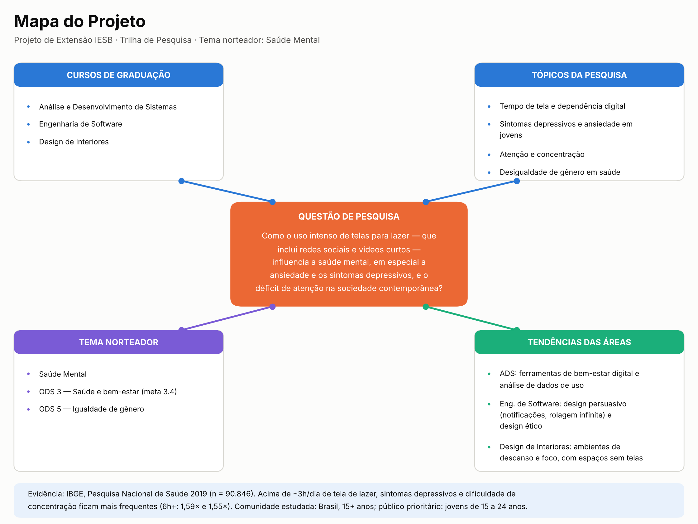
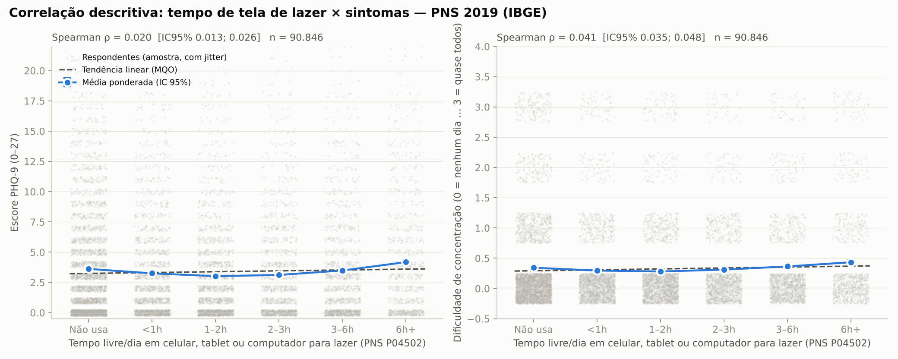
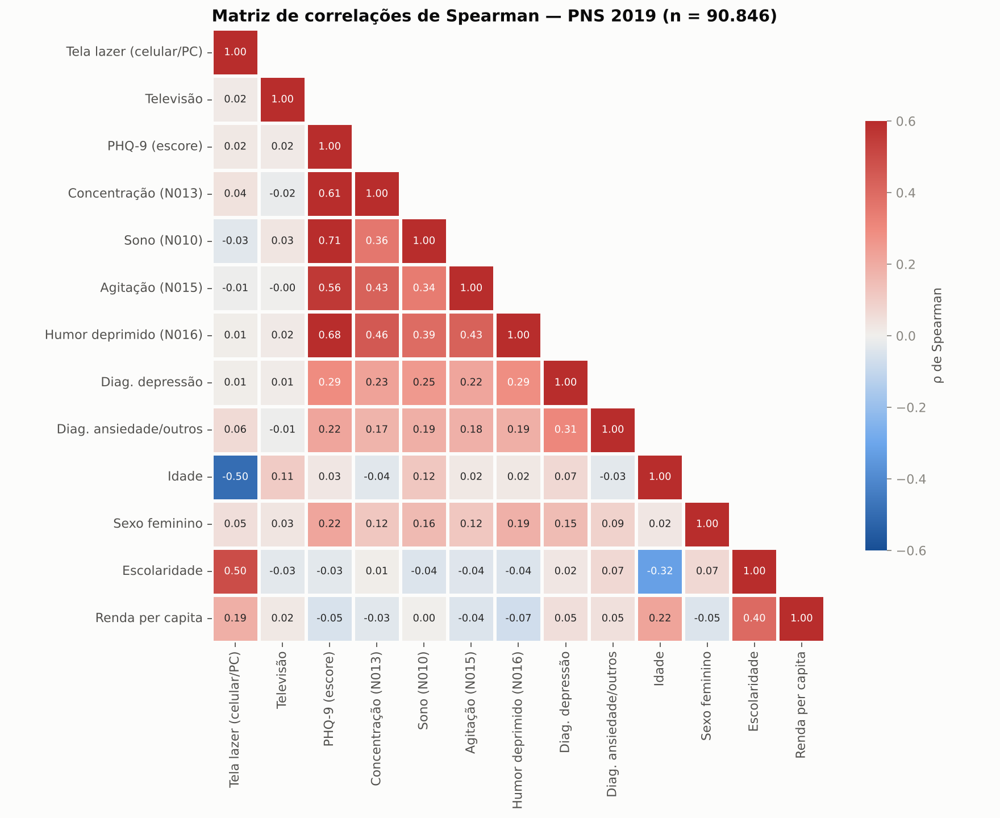
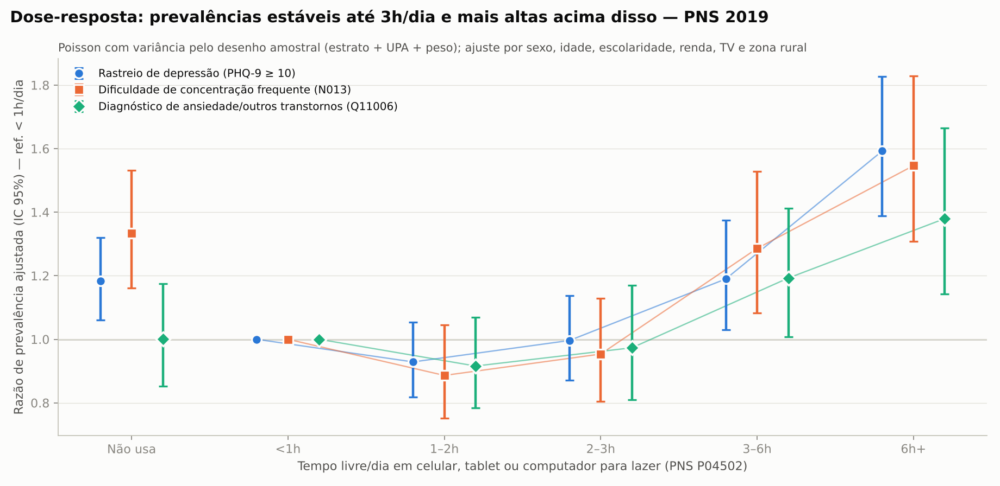
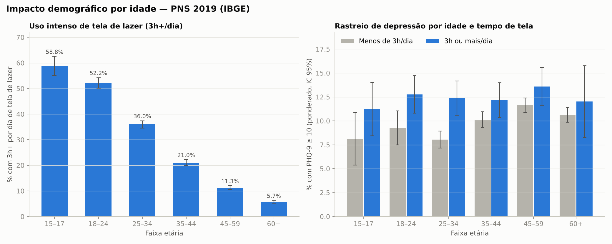
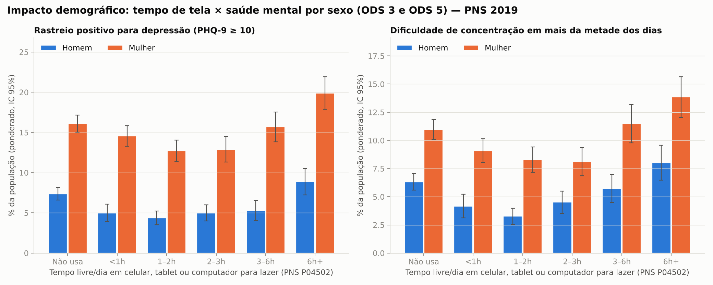
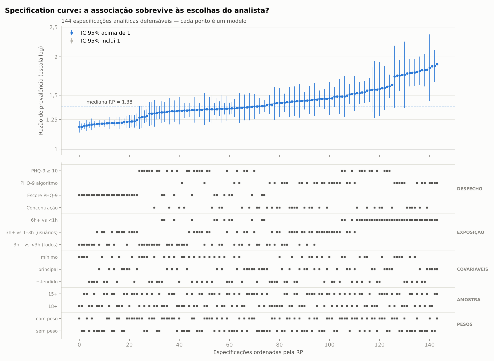

# Uso Intenso de Telas e Saúde Mental no Brasil: Evidências da Pesquisa Nacional de Saúde 2019

**Relatório Final da Pesquisa**

| | |
|---|---|
| **Instituição** | Centro Universitário IESB |
| **Disciplina** | Projeto de Extensão na Educação Superior · Trilha de Pesquisa |
| **Professor orientador** | Prof. Guilherme Bueno |
| **Tema norteador** | Saúde Mental |
| **ODS** | ODS 3 — Saúde e Bem-Estar (meta 3.4: promover a saúde mental e o bem-estar) · ODS 5 — Igualdade de Gênero |
| **Cursos do grupo** | Análise e Desenvolvimento de Sistemas · Engenharia de Software · Design de Interiores |
| **Comunidade estudada** | Brasil — população de 15 anos ou mais (PNS 2019); público prioritário: jovens de 15 a 24 anos |
| **Ano** | 2026 |

> **Como ler este relatório.** Este é o documento oficial da pesquisa, de ponta a ponta. Cada seção indica o arquivo do repositório que a sustenta, e o [mapa da seção 9](#9-mapa-dos-anexos-e-arquivos) lista todos eles.

---

## Resumo

Este estudo analisou a associação entre o tempo de uso de telas para lazer e a saúde mental na população brasileira. Utilizaram-se os microdados da Pesquisa Nacional de Saúde 2019 (IBGE), com 90.846 pessoas de 15 anos ou mais. Calcularam-se prevalências e razões de prevalência ajustadas, considerando o desenho amostral. A relação não foi linear: até cerca de três horas diárias não houve aumento de sintomas, mas com seis horas ou mais o rastreio positivo para depressão foi 1,59 vez mais frequente e a dificuldade de concentração, 1,55 vez. O uso intenso concentrou-se entre jovens, e as mulheres apresentaram prevalência de sintomas depressivos 2,5 vezes maior. O resultado manteve-se em 144 análises alternativas. Conclui-se que o uso intenso, e não o uso moderado, está associado a pior saúde mental, o que orienta ações de promoção do uso equilibrado de telas.

**Palavras-chave:** saúde mental; tempo de tela; depressão; atenção; Pesquisa Nacional de Saúde.

## Abstract

This study analyzed the association between recreational screen time and mental health in the Brazilian population. Microdata from the 2019 National Health Survey (IBGE) were used, covering 90,846 people aged 15 or older. Prevalences and adjusted prevalence ratios were estimated, accounting for the complex sample design. The relationship was not linear: up to about three hours per day there was no increase in symptoms, but at six hours or more a positive depression screen was 1.59 times as frequent and difficulty concentrating 1.55 times as frequent. Heavy use was concentrated among young people, and women showed a 2.5-fold higher prevalence of depressive symptoms. The result held across 144 alternative analyses. Heavy use, rather than moderate use, is associated with poorer mental health, which supports actions promoting balanced screen use.

**Keywords:** mental health; screen time; depression; attention; National Health Survey.

---

## 1. Introdução

A Organização Mundial da Saúde define saúde mental como um estado de bem-estar que permite reconhecer as próprias capacidades, lidar com as tensões da vida, aprender, trabalhar e contribuir com a comunidade. Estima-se que cerca de 970 milhões de pessoas viviam com algum transtorno mental em 2019 (WORLD HEALTH ORGANIZATION, 2022). No Brasil, a Pesquisa Nacional de Saúde de 2019 (IBGE, 2022) mediu sintomas depressivos com o Patient Health Questionnaire-9 (PHQ-9), questionário de nove itens validado internacionalmente (KROENKE; SPITZER; WILLIAMS, 2001) e no Brasil (SANTOS et al., 2013).

Com base nessa pesquisa, Melo et al. (2023) estimaram que 10,8% dos brasileiros adultos apresentam rastreio positivo para depressão. Ao mesmo tempo, o uso de telas no lazer tornou-se parte do cotidiano, e estudos com a mesma base associaram comportamentos de tela a sintomas depressivos (SILVA et al., 2021). O tema mobiliza um debate internacional: Haidt (2024) atribui o aumento do sofrimento entre jovens ao uso de smartphones e redes sociais, enquanto Odgers (2024) argumenta que a evidência disponível não sustenta uma relação de causa.

A literatura recente ajuda a dimensionar esse debate. Em revisão sistemática de 50 estudos, Santos et al. (2023) concluíram que o tempo excessivo de tela em adolescentes parece associado a problemas de saúde mental, com maior risco de depressão entre as meninas que usam redes sociais. A metanálise de Liu et al. (2022) estimou que cada hora diária adicional em redes sociais se associa a uma chance 13% maior de depressão em adolescentes, com associação mais forte entre as meninas. Quanto à atenção, Thorell et al. (2024) encontraram, em 28 estudos longitudinais, relações nos dois sentidos entre o uso de mídias digitais e sintomas de TDAH. Já a revisão de estudos longitudinais de Tang et al. (2021) estimou efeitos pequenos ou muito pequenos, o que mantém em aberto a magnitude e a direção dessas associações. Ainda assim, o tema chegou às políticas públicas: o Surgeon General dos Estados Unidos alertou que adolescentes que passam mais de três horas por dia em redes sociais têm o dobro do risco de sintomas de depressão e ansiedade (UNITED STATES, 2023), e, no Brasil, 93% das crianças e adolescentes de 9 a 17 anos já usam a internet (CGI.BR, 2025).

Diante desse cenário, esta pesquisa busca responder à seguinte questão:

> **Como o uso intenso de telas para lazer — que inclui redes sociais e vídeos curtos — influencia a saúde mental, em especial a ansiedade e os sintomas depressivos, e o déficit de atenção na sociedade contemporânea?**

A pesquisa se justifica pela necessidade de substituir impressões por evidências representativas da população brasileira, capazes de orientar ações de promoção da saúde mental (ODS 3, meta 3.4) e de considerar desigualdades de gênero (ODS 5). Seu objetivo é analisar a associação entre o tempo de tela no lazer e a saúde mental dos brasileiros com 15 anos ou mais, identificando a partir de que nível de uso essa associação aparece e quais grupos são mais afetados.

O mapa a seguir resume o projeto: a questão de pesquisa ao centro, ligada aos cursos do grupo, aos tópicos, ao tema norteador e às tendências das áreas.

*Mapa do Projeto — a questão de pesquisa ao centro, ligada aos demais elementos. Arquivo: `resultados/figuras/Mapa_do_Projeto.png` (gerado por `codigo/mapa_do_projeto.py`).*

## 2. Objetivos e hipóteses

**Objetivo geral:** analisar a associação entre o tempo de uso de telas para lazer e a saúde mental (sintomas depressivos, ansiedade e dificuldade de concentração) na população brasileira com 15 anos ou mais, identificando a partir de que nível de uso essa associação aparece e quais grupos são mais afetados.

**Objetivos específicos:**

1. Identificar, entre as bases de dados oficiais brasileiras, a que permite relacionar tempo de tela e saúde mental no mesmo indivíduo.
2. Descrever o perfil do uso de telas para lazer por idade, sexo e renda.
3. Determinar a prevalência de sintomas depressivos, dificuldade de concentração e diagnóstico de ansiedade em cada faixa de tempo de tela.
4. Verificar se existe um limiar de tempo a partir do qual essa prevalência aumenta.
5. Avaliar se a associação difere entre homens e mulheres e entre faixas etárias.

**Hipóteses:**

| Hipótese | Enunciado |
|---|---|
| **H1** (principal) | Entre quem usa telas no lazer, mais tempo de uso está associado a maior prevalência de sintomas depressivos (PHQ-9 ≥ 10). |
| **H2** | O uso intenso de telas está associado a maior frequência de dificuldade de concentração. |
| **H3** | O uso intenso de telas está associado a maior frequência de diagnóstico de ansiedade ou outros transtornos mentais. |
| **H4** | A associação é mais forte entre as mulheres (ODS 5). |
| **H5** | A associação é mais forte entre os jovens. |

O limiar de cerca de 3 horas por dia **não** era uma hipótese prévia: surgiu durante a análise e é tratado como resultado exploratório ([Anexo C](anexos/Anexo_C_Rigor_Metodologico.md), §3).

## 3. Métodos

### 3.1 Tipo de estudo e base de dados
Estudo quantitativo, transversal, com dados secundários oficiais (levantamento) e pesquisa bibliográfica. Foram avaliadas seis bases oficiais (IBGE, Cetic.br e DATASUS). A **Pesquisa Nacional de Saúde 2019** foi escolhida por ser a única pública, oficial e representativa do país que mede, na mesma pessoa, tempo de tela, saúde mental com instrumento validado, sexo, idade e pesos amostrais (STOPA et al., 2020). Detalhes: [Anexo A](anexos/Anexo_A_Selecao_da_Base_de_Dados.md).

### 3.2 Variáveis

| Dimensão | Variável (código IBGE) | Descrição |
|---|---|---|
| Exposição | **P04502** | Horas por dia do tempo livre em celular, tablet ou computador para lazer ("redes sociais, notícias, vídeos, jogar") |
| Desfecho principal | **PHQ-9** (N010–N018) | Sintomas depressivos nas últimas 2 semanas; ≥ 10 = rastreio positivo |
| Atenção | **N013** | Dificuldade de concentração nas atividades habituais |
| Ansiedade | **Q11006** | Diagnóstico autorreferido de transtorno de ansiedade ou outro transtorno mental |
| Demografia e controles | C006, C008, VDD004A, VDF004 | Sexo, idade, escolaridade, renda |
| Desenho amostral | V00291, V0024, UPA_PNS | Peso, estrato e conglomerado |

### 3.3 Amostra e preparação dos dados

| Etapa | Registros |
|---|---:|
| Registros no arquivo do IBGE | 293.726 |
| Moradores selecionados para a entrevista individual | 94.114 |
| **Entrevistas realizadas (amostra final)** | **90.846** |

Foram excluídas 3.268 pessoas (recusa ou não encontradas). As posições das 32 variáveis foram conferidas automaticamente com o layout oficial, e os códigos de resposta, com o dicionário do IBGE. A amostra representa cerca de **168 milhões** de brasileiros com 15 anos ou mais. A margem de erro da prevalência principal é de cerca de ±0,4 ponto percentual (IC 95%). Procedimento completo e replicável: [Anexo B](anexos/Anexo_B_Obtencao_e_Preparacao_dos_Dados.md).

### 3.4 Análise estatística

| Elemento | Escolha | Por quê |
|---|---|---|
| Medida de efeito | **Razão de prevalência (RP)**, por regressão de Poisson com variância robusta | Com desfecho comum (~11%), o *odds ratio* superestima o efeito (BARROS; HIRAKATA, 2003) |
| Inferência | Desenho amostral completo (estrato, 8.027 UPAs e peso), por linearização de Taylor | Ignorar o desenho subestima os erros-padrão (LUMLEY, 2004) |
| Ajuste | Sexo, idade, escolaridade, renda, TV e zona rural; modelo estendido com estado civil, ocupação e região | Controlar fatores de confusão |
| Hipóteses | H1 principal; demais com correção de multiplicidade (Benjamini-Hochberg) | Evitar falsos positivos |
| Interação | Escalas multiplicativa e aditiva | Recomendação de Knol e VanderWeele (2012) |
| Robustez | *Specification curve* com 144 análises; E-value | Simonsohn, Simmons e Nelson (2020); VanderWeele e Ding (2017) |

Ferramentas: Python (pandas, NumPy, SciPy, statsmodels, matplotlib, seaborn), com testes automáticos. Código: pasta [`codigo/`](codigo/). O rigor metodológico, a checklist STROBE (VON ELM et al., 2007) e o histórico das decisões estão no [Anexo C](anexos/Anexo_C_Rigor_Metodologico.md).

**Validação externa:** o pipeline reproduz as duas prevalências publicadas para a mesma base (MELO et al., 2023): **10,78%** de rastreio positivo para depressão (publicado: 10,8%) e **5,63%** pelo algoritmo do PHQ-9 (publicado: 5,7%).

### 3.5 Aspectos éticos
Dados públicos e anonimizados, sem contato com participantes. A pesquisa enquadra-se nas exceções do art. 1º, parágrafo único, da Resolução CNS nº 510/2016 e não requer apreciação pelo sistema CEP/Conep.

## 4. Resultados

### 4.1 A correlação simples foi desprezível

| Tempo de tela de lazer × | Spearman ρ | IC 95% |
|---|---:|---|
| PHQ-9 (escore) | 0,020 | [0,013; 0,026] |
| Concentração (N013) | 0,041 | [0,035; 0,048] |
| Diagnóstico de ansiedade/outros | 0,062 | [0,055; 0,068] |
| PHQ-9, parcial (controle: idade, sexo, escolaridade, renda) | 0,052 | [0,045; 0,058] |

*Figura 1 — Correlação entre tempo de tela de lazer e sintomas. Arquivo: `resultados/figuras/Figura_1_Correlacao_tempo_de_tela_e_sintomas.png`.*

A correlação foi baixa por dois motivos. Primeiro, a relação não se mostrou linear (seção 4.2). Segundo, o tempo de tela apresentou forte correlação com a idade (ρ = −0,50, Figura 2): os grupos com mais sintomas, os que **não usavam** telas (mais velhos e mais pobres) e os que usavam **6h ou mais** (mais jovens), ficaram em extremos opostos e "anularam" a reta.

*Figura 2 — Matriz de correlações entre as variáveis. Arquivo: `resultados/figuras/Figura_2_Matriz_de_correlacoes.png`.*

### 4.2 Dose-resposta: o risco apareceu acima de cerca de 3 horas por dia

Razão de prevalência ajustada (referência: menos de 1h/dia), com desenho amostral completo (n = 90.824):

| Tela de lazer/dia | PHQ-9 ≥ 10 | Concentração frequente | Diagnóstico de ansiedade/outros |
|---|---|---|---|
| Não usa | 1,18 [1,06; 1,32] | 1,33 [1,16; 1,53] | 1,00 [0,85; 1,18] |
| < 1h (referência) | 1 | 1 | 1 |
| 1–2h | 0,93 [0,82; 1,05] | 0,89 [0,75; 1,05] | 0,92 [0,78; 1,07] |
| 2–3h | 1,00 [0,87; 1,14] | 0,95 [0,81; 1,13] | 0,97 [0,81; 1,17] |
| **3–6h** | **1,19 [1,03; 1,37]** | **1,29 [1,08; 1,53]** | 1,19 [1,01; 1,41] (q = 0,07) |
| **6h ou mais** | **1,59 [1,39; 1,83]** | **1,55 [1,31; 1,83]** | **1,38 [1,14; 1,66]** |

| Teste formal (PHQ-9 ≥ 10) | Resultado |
|---|---|
| H1: tendência entre usuários | RP 1,12 por faixa [1,08; 1,16], p < 0,001 |
| Não linearidade | χ² = 22,7 (3 gl), p < 0,001 |
| Faixas abaixo de 3h iguais a < 1h? | p = 0,46: sem diferença |
| Faixas acima de 3h iguais a < 1h? | p < 0,001: com diferença |

*Figura 3 — Dose-resposta: razão de prevalência por faixa de tempo de tela (acima da linha 1 = mais frequente que em quem usa menos de 1h). Arquivo: `resultados/figuras/Figura_3_Dose_resposta_limiar_de_3h.png`.*

Até cerca de 3 horas por dia não houve aumento de sintomas. Acima disso, a prevalência subiu nos três desfechos. O grupo que não usava telas também ficou acima de 1, efeito atribuível ao seu perfil (47% tinham 60 anos ou mais e 67% viviam com até 1 salário mínimo por pessoa), e não à ausência de telas.

### 4.3 Idade: a exposição foi maior entre os jovens, e o efeito, igual

| Indicador | 15–17 | 18–24 | 25–34 | 35–44 | 45–59 | 60+ |
|---|---:|---:|---:|---:|---:|---:|
| Usa 3h+/dia | **58,8%** | **52,2%** | 36,0% | 21,0% | 11,3% | 5,7% |
| Usa 6h+/dia | **31,9%** | **25,3%** | 13,5% | 6,9% | 3,4% | 1,7% |

*Figura 4 — Exposição ao uso intenso e sintomas por faixa etária. Arquivo: `resultados/figuras/Figura_4_Exposicao_por_idade.png`.*

O efeito do uso intenso foi semelhante entre jovens de 15–24 anos (RP 1,40) e pessoas com 25 anos ou mais (RP 1,34). A interação não foi significativa (p = 0,75). Os jovens mostraram-se mais **expostos**, não mais sensíveis.

### 4.4 Sexo (ODS 5)

| Indicador | Homens | Mulheres |
|---|---:|---:|
| Usa 3h+/dia | 24,1% | 24,3% |
| Rastreio positivo para depressão (geral) | **6,0%** | **15,1%** |
| Rastreio positivo com 6h+/dia | 8,9% | **19,9%** |
| Razão de prevalência mulher × homem (ajustada) | — | **2,49** [2,29; 2,71] |
| Excesso absoluto do uso de 3h+ | +2,5 p.p. [1,2; 3,8] | +4,4 p.p. [2,8; 6,0] |

*Figura 5 — Sintomas por tempo de tela, homens e mulheres. Arquivo: `resultados/figuras/Figura_5_Comparacao_por_sexo.png`.*

Homens e mulheres usavam telas na mesma proporção, mas as mulheres apresentaram uma carga de sintomas 2,5 vezes maior. Na escala relativa, o efeito do uso intenso foi semelhante (p = 0,37). Na escala absoluta, houve indício de que ele somasse mais casos entre as mulheres (RERI = 0,48; diferença direta p = 0,052): o resultado foi **sugestivo, não comprovado**.

### 4.5 Robustez

| Análise | Resultado |
|---|---|
| *Specification curve* (144 análises: 4 desfechos × 3 exposições × 3 conjuntos de ajuste × 2 amostras × com/sem peso) | **144 de 144** com RP > 1 e intervalo acima de 1; mediana 1,38 (1,18 a 1,89) |
| E-value (6h+, PHQ-9 ≥ 10) | 2,56 (limite do IC: 2,12) |
| Modelo bruto → ajustado → estendido (6h+) | RP 1,45 → 1,59 → 1,54 |

*Figura 6 — Robustez: resultado em 144 análises alternativas (cada ponto é uma análise). Arquivo: `resultados/figuras/Figura_6_Robustez_144_analises.png`.*

### 4.6 Teste das hipóteses

| Hipótese | Resultado |
|---|---|
| H1 — mais tela, mais sintomas depressivos | ✅ **Confirmada:** +12% de prevalência por faixa de tempo (RP 1,12) |
| H2 — uso intenso e dificuldade de concentração | ✅ **Confirmada:** RP 1,55 com 6h+ |
| H3 — uso intenso e diagnóstico de ansiedade | 🟡 **Parcialmente confirmada:** RP 1,38 com 6h+; entre 3 e 6 horas a associação não se manteve após a correção para múltiplas comparações |
| H4 — associação mais forte nas mulheres | 🟡 **Não confirmada na escala relativa;** indício de mais casos absolutos entre elas |
| H5 — associação mais forte nos jovens | ❌ **Refutada:** efeito semelhante em todas as idades |

## 5. Discussão

O estudo demonstrou que a relação entre tempo de tela e saúde mental **não é linear**, o que vai ao encontro da "hipótese Goldilocks" de Przybylski e Weinstein (2017), segundo a qual o uso moderado da tecnologia não é prejudicial e o uso excessivo, sim. Os resultados também se aproximam do que Werneck et al. (2018) observaram para a televisão na PNS 2013, com mais sintomas depressivos nos extremos de uso.

O efeito, embora consistente, é moderado em escala individual, o que dialoga com Orben e Przybylski (2019), que encontraram associações pequenas entre tecnologia e bem-estar em adolescentes. Ainda assim, a relevância populacional é grande: **40,8 milhões** de brasileiros usam telas no lazer por 3 horas ou mais por dia, **16,6 milhões** por 6 horas ou mais, e entre estes últimos **2,4 milhões** têm rastreio positivo para depressão.

O limiar exploratório de cerca de 3 horas fica próximo do patamar que o Surgeon General dos Estados Unidos destacou para redes sociais entre adolescentes (UNITED STATES, 2023), embora as medidas e as populações sejam diferentes. Na escala relativa, porém, não encontramos efeito mais forte entre as mulheres, ao contrário do que Liu et al. (2022) observaram entre meninas adolescentes; a diferença pode refletir a faixa etária mais ampla e o fato de a PNS medir o tempo total de tela, e não apenas o de redes sociais. A associação com a dificuldade de concentração é coerente com as relações entre mídias digitais e sintomas de desatenção descritas por Thorell et al. (2024).

Os resultados apoiam a preocupação com o uso intenso (HAIDT, 2024), mas, por virem de um estudo transversal, não permitem afirmar que as telas causam os sintomas, cautela defendida por Odgers (2024) e coerente com os efeitos pequenos encontrados em estudos longitudinais (TANG et al., 2021). Por fim, a carga 2,5 vezes maior entre mulheres reforça que a saúde mental também é uma questão de desigualdade de gênero (ODS 5).

## 6. Limitações

1. **Estudo transversal:** mostra associação, não causa. Pessoas em sofrimento também podem buscar mais as telas.
2. **Tipo de conteúdo:** a pergunta do IBGE não separa vídeos curtos de redes sociais, notícias e jogos.
3. **Tempo não é dependência:** a PNS mede horas de uso, não perda de controle ou uso problemático.
4. **Ansiedade:** medida apenas por diagnóstico autorreferido, que agrupa transtornos e depende de acesso a serviços.
5. **Concentração:** medida por um único item do PHQ-9, que não equivale a um diagnóstico de TDAH.
6. **Data:** dados de 2019, antes da pandemia e da popularização dos vídeos curtos.
7. **Limiar exploratório:** o valor de cerca de 3 horas surgiu da análise, não de uma hipótese prévia.

Detalhamento dos vieses: [Anexo C](anexos/Anexo_C_Rigor_Metodologico.md), §8.

## 7. Conclusão e implicações práticas

Com dados oficiais de 90.846 pessoas, concluiu-se que o uso moderado de telas para lazer, até cerca de 3 horas por dia, não está associado a mais sintomas. **O uso intenso está:** com 6 horas ou mais, sintomas depressivos e dificuldade de concentração são cerca de 1,6 vez mais frequentes. O uso intenso concentra-se nos jovens, e as mulheres carregam mais que o dobro da carga de sofrimento.

**Implicações práticas:**

1. **Equilíbrio, não abstinência:** ações de promoção da saúde mental podem ter como meta manter o lazer em telas abaixo de cerca de 3 horas por dia, com atenção especial a quem passa de 6 horas.
2. **Público prioritário:** jovens de 15 a 24 anos, entre os quais 1 em cada 3 adolescentes usa telas por 6 horas ou mais. O perfil desse público está no [Anexo E](anexos/Anexo_E_Perfil_do_Publico_Alvo.md).
3. **Recorte de gênero:** as mulheres jovens com uso intenso formam o grupo de maior prevalência de sintomas (20,7%).
4. **Sono e concentração** são queixas frequentes e concretas, úteis para comunicar o tema.
5. **Limites éticos:** ações de extensão promovem saúde e informam; não fazem diagnóstico nem avaliação clínica, e devem indicar a rede de apoio (CVV 188, UBS, CAPS).

As causas e os efeitos do problema estão organizados no [Anexo D](anexos/Anexo_D_Arvore_de_Problemas.md), as questões para estudos futuros, no [Anexo F](anexos/Anexo_F_Referencias_e_Questoes_Futuras.md), e os fichamentos da literatura e dos achados, no [Anexo G](anexos/Anexo_G_Literatura_Periodicos_e_Fichamentos.md).

## 8. Referências

BARROS, A. J. D.; HIRAKATA, V. N. Alternatives for logistic regression in cross-sectional studies: an empirical comparison of models that directly estimate the prevalence ratio. *BMC Medical Research Methodology*, v. 3, art. 21, 2003.

BRASIL. Conselho Nacional de Saúde. Resolução nº 510, de 7 de abril de 2016.

CGI.BR — COMITÊ GESTOR DA INTERNET NO BRASIL. *Pesquisa sobre o uso da internet por crianças e adolescentes no Brasil: TIC Kids Online Brasil 2024*. São Paulo: CGI.br, 2025. Disponível em: https://cetic.br/media/docs/publicacoes/2/20250512154015/tic_kids_online_2024_resumo_executivo.pdf. Acesso em: 20 nov. 2026.

HAIDT, J. *The anxious generation: how the great rewiring of childhood is causing an epidemic of mental illness*. 2024.

IBGE. *Pesquisa Nacional de Saúde 2019: microdados*. Rio de Janeiro: IBGE, 2022. Disponível em: https://ftp.ibge.gov.br/PNS/2019/Microdados/. Acesso em: 20 nov. 2026.

KNOL, M. J.; VANDERWEELE, T. J. Recommendations for presenting analyses of effect modification and interaction. *International Journal of Epidemiology*, v. 41, n. 2, p. 514-520, 2012.

KROENKE, K.; SPITZER, R. L.; WILLIAMS, J. B. The PHQ-9: validity of a brief depression severity measure. *Journal of General Internal Medicine*, v. 16, n. 9, p. 606-613, 2001.

LIU, M. et al. Time spent on social media and risk of depression in adolescents: a dose–response meta-analysis. *International Journal of Environmental Research and Public Health*, v. 19, n. 9, art. 5164, 2022. Disponível em: https://www.mdpi.com/1660-4601/19/9/5164. Acesso em: 20 nov. 2026.

LUMLEY, T. Analysis of complex survey samples. *Journal of Statistical Software*, v. 9, n. 1, p. 1-19, 2004.

MELO, A. P. S. et al. Depression screening in a population-based study: Brazilian National Health Survey 2019. *Ciência & Saúde Coletiva*, v. 28, n. 4, p. 1163-1174, 2023. Disponível em: https://www.scielo.br/j/csc/a/wWKFtv8ZVZZTwVDM94Q3gFt/. Acesso em: 20 nov. 2026.

ODGERS, C. L. [Resenha de *The anxious generation*, de J. Haidt]. *Nature*, 2024. Disponível em: https://www.nature.com/articles/d41586-024-00902-2. Acesso em: 20 nov. 2026.

ORBEN, A.; PRZYBYLSKI, A. K. The association between adolescent well-being and digital technology use. *Nature Human Behaviour*, v. 3, p. 173-182, 2019.

PRZYBYLSKI, A. K.; WEINSTEIN, N. A large-scale test of the Goldilocks hypothesis. *Psychological Science*, v. 28, n. 2, p. 204-215, 2017.

SANTOS, I. S. et al. Sensibilidade e especificidade do Patient Health Questionnaire-9 (PHQ-9) entre adultos da população geral. *Cadernos de Saúde Pública*, v. 29, n. 8, p. 1533-1543, 2013.

SANTOS, R. M. S. et al. The associations between screen time and mental health in adolescents: a systematic review. *BMC Psychology*, v. 11, art. 127, 2023. Disponível em: https://doi.org/10.1186/s40359-023-01166-7. Acesso em: 20 nov. 2026.

SILVA, D. R. et al. Correlates of screen-based behaviors among adults from the 2019 Brazilian National Health Survey. *BMC Public Health*, v. 21, art. 2289, 2021. Disponível em: https://doi.org/10.1186/s12889-021-12340-0. Acesso em: 20 nov. 2026.

SIMONSOHN, U.; SIMMONS, J. P.; NELSON, L. D. Specification curve analysis. *Nature Human Behaviour*, v. 4, p. 1208-1214, 2020.

STOPA, S. R. et al. Pesquisa Nacional de Saúde 2019: histórico, métodos e perspectivas. *Epidemiologia e Serviços de Saúde*, v. 29, n. 5, e2020315, 2020.

TANG, S. et al. The relationship between screen time and mental health in young people: a systematic review of longitudinal studies. *Clinical Psychology Review*, v. 86, art. 102021, 2021. Disponível em: https://pubmed.ncbi.nlm.nih.gov/33798997/. Acesso em: 20 nov. 2026.

THORELL, L. B. et al. Longitudinal associations between digital media use and ADHD symptoms in children and adolescents: a systematic literature review. *European Child & Adolescent Psychiatry*, v. 33, n. 8, p. 2503-2526, 2024. Disponível em: https://doi.org/10.1007/s00787-022-02130-3. Acesso em: 20 nov. 2026.

UNITED STATES. Office of the Surgeon General. *Social media and youth mental health: the U.S. Surgeon General's advisory*. Washington, DC: U.S. Department of Health and Human Services, 2023. Disponível em: https://www.hhs.gov/sites/default/files/sg-youth-mental-health-social-media-advisory.pdf. Acesso em: 20 nov. 2026.

VANDERWEELE, T. J.; DING, P. Sensitivity analysis in observational research: introducing the E-value. *Annals of Internal Medicine*, v. 167, n. 4, p. 268-274, 2017.

VON ELM, E. et al. The Strengthening the Reporting of Observational Studies in Epidemiology (STROBE) statement. *PLoS Medicine*, v. 4, n. 10, e296, 2007.

WERNECK, A. O. et al. Associations between TV viewing and depressive symptoms among 60,202 Brazilian adults: the Brazilian National Health Survey. *Journal of Affective Disorders*, v. 236, p. 23-30, 2018.

WORLD HEALTH ORGANIZATION. *World mental health report: transforming mental health for all*. Geneva: WHO, 2022.

## 9. Mapa dos anexos e arquivos

| O que é | Onde está |
|---|---|
| **Anexo A** — Como e por que a base de dados foi escolhida; variáveis exatas | [`anexos/Anexo_A_Selecao_da_Base_de_Dados.md`](anexos/Anexo_A_Selecao_da_Base_de_Dados.md) |
| **Anexo B** — Obtenção e preparação dos dados; procedimento replicável | [`anexos/Anexo_B_Obtencao_e_Preparacao_dos_Dados.md`](anexos/Anexo_B_Obtencao_e_Preparacao_dos_Dados.md) |
| **Anexo C** — Rigor metodológico, STROBE, ética, histórico das decisões | [`anexos/Anexo_C_Rigor_Metodologico.md`](anexos/Anexo_C_Rigor_Metodologico.md) |
| **Anexo D** — Árvore de problemas (causas e efeitos) | [`anexos/Anexo_D_Arvore_de_Problemas.md`](anexos/Anexo_D_Arvore_de_Problemas.md) |
| **Anexo E** — Perfil do público-alvo | [`anexos/Anexo_E_Perfil_do_Publico_Alvo.md`](anexos/Anexo_E_Perfil_do_Publico_Alvo.md) |
| **Anexo F** — Referências completas e questões futuras | [`anexos/Anexo_F_Referencias_e_Questoes_Futuras.md`](anexos/Anexo_F_Referencias_e_Questoes_Futuras.md) |
| **Anexo G** — Periódicos consultados, artigos correlacionados, fichamentos e fichamento dos achados | [`anexos/Anexo_G_Literatura_Periodicos_e_Fichamentos.md`](anexos/Anexo_G_Literatura_Periodicos_e_Fichamentos.md) |
| **Mapa do Projeto** (seção 1) | [`resultados/figuras/Mapa_do_Projeto.png`](resultados/figuras/Mapa_do_Projeto.png) · gerado por [`codigo/mapa_do_projeto.py`](codigo/mapa_do_projeto.py) |
| **Figuras 1 a 6** | [`resultados/figuras/`](resultados/figuras/) |
| Todas as tabelas de resultados | [`resultados/tabelas/resultados_estatisticos.md`](resultados/tabelas/resultados_estatisticos.md) (versão de dados: `.json`) |
| Indicadores por grupo (planilha) | [`resultados/tabelas/indicadores_por_grupo.csv`](resultados/tabelas/indicadores_por_grupo.csv) |
| Registro da preparação dos dados (auditoria) | [`resultados/tabelas/relatorio_preparacao_dos_dados.json`](resultados/tabelas/relatorio_preparacao_dos_dados.json) |
| Código: preparação dos dados → análise | [`codigo/preparacao_dos_dados.py`](codigo/preparacao_dos_dados.py) → [`codigo/analise_estatistica.py`](codigo/analise_estatistica.py) (métodos em [`codigo/metodos_amostrais.py`](codigo/metodos_amostrais.py)) |
| Testes automáticos do código | [`codigo/testes/`](codigo/testes/) |
