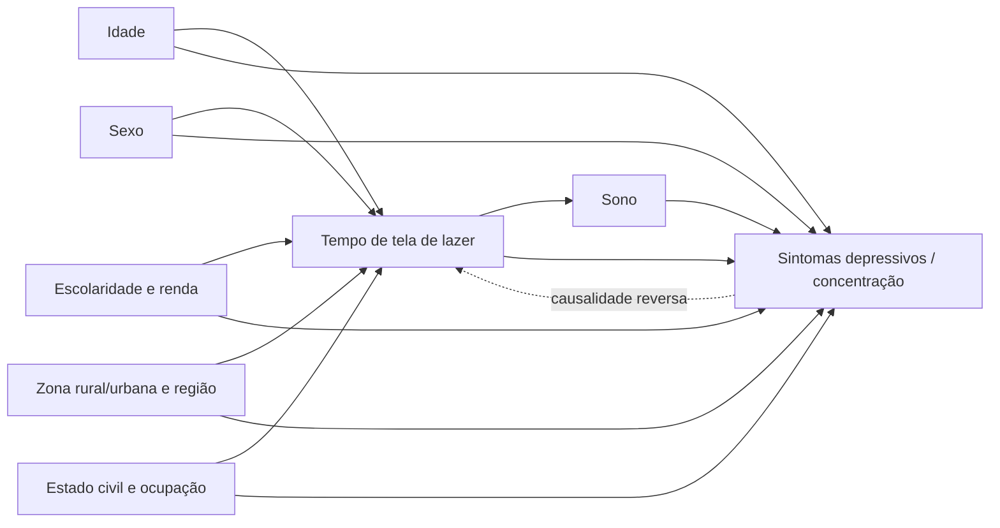

# Rigor Metodológico — diagnóstico, correções e reavaliação da linha de pesquisa

**Projeto de Extensão IESB · Grupo 1 · Revisão metodológica de 01/11/2026**

Este documento responde a quatro perguntas da equipe:
1. Aplicamos as melhores técnicas de análise de dados complexos?
2. Seguimos uma estrutura reconhecida internacionalmente?
3. Usamos o método científico corretamente?
4. O que separa este trabalho de uma publicação?

A resposta é honesta: **o núcleo estava correto, mas havia lacunas que um revisor apontaria.** Elas foram corrigidas nesta revisão, e **duas conclusões mudaram** (seção 4).

---

## 1. Resposta curta

| Pergunta | Antes da revisão | Depois da revisão |
|---|---|---|
| Técnicas de análise de dados complexos | Pesos amostrais nas prevalências; regressão logística com EP só por conglomerado | **Desenho completo (estrato + UPA + peso) em todos os modelos**, com estimação por domínio (`metodos_amostrais.py`, validado por testes) |
| Estrutura internacional | Nenhum checklist formal | Checklist **STROBE** (seção 6) + recomendações de relato de interação (Knol & VanderWeele, 2012) |
| Método científico | Pergunta → dados → análise, mas **sem hierarquia de hipóteses declarada**, e com análises acrescentadas depois de ver os dados | Hipótese primária declarada; secundárias com correção de multiplicidade; o exploratório é rotulado como tal; histórico analítico transparente (seção 3); specification curve contra a flexibilidade analítica |
| Distância até uma publicação | Material de dossiê | Base de nível de **congresso/anais** com fundamentos de periódico. Os passos que faltam estão em [`05_Agenda_de_Pesquisa.md`](05_Agenda_de_Pesquisa.md) |

---

## 2. O método científico aplicado, etapa por etapa

| Etapa | O que fizemos | Evidência no repositório |
|---|---|---|
| **1. Pergunta** | Pergunta de pesquisa ajustada ao que os dados medem | `docs/Guia_Operacional_G1.md` §1 |
| **2. Revisão do conhecimento** | Mapeamento de 6 bases oficiais; posicionamento frente a estudos que já usam a PNS | `docs/01`, `docs/05` |
| **3. Hipóteses** | H1 primária + secundárias + exploratórias (abaixo) | `analise_exploratoria.py` (docstring) |
| **4. Operacionalização** | Cada construto ligado a uma variável oficial, com códigos conferidos contra o dicionário do IBGE | `etl_processor.py`, `docs/01` §3 |
| **5. Coleta** | Fonte primária (FTP do IBGE), com integridade registrada (SHA-256 do arquivo) | `data/processed/etl_relatorio.json` |
| **6. Validação da medida** | Reproduzimos as **duas** prevalências oficiais publicadas (seção 5) | `outputs/resultados_estatisticos.md` §0 |
| **7. Análise** | Medida de efeito adequada (RP), desenho amostral, confundidores via DAG, testes formais, robustez | §4 deste documento |
| **8. Inferência** | Força de evidência graduada por afirmação; associação ≠ causalidade | `Dossie_Evidencias_Quantitativas.md` |
| **9. Comunicação** | STROBE, limitações, agenda de pesquisa | este documento + `docs/05` |
| **10. Reprodutibilidade** | Código aberto, testes, versões fixadas, hash dos dados | `tests/`, `requirements.txt` |

### Hierarquia de hipóteses

| Nível | Hipótese | Como foi testada |
|---|---|---|
| **Primária (H1)** | Entre usuários, mais tempo de tela de lazer (P04502) associa-se a maior prevalência de rastreio positivo para depressão (PHQ-9 ≥ 10), após ajuste | Tendência ordinal, Poisson com desenho completo |
| Secundárias | O mesmo para dificuldade de concentração frequente (N013) e diagnóstico de ansiedade/outros (Q11006); modificação de efeito por sexo (ODS 5) e por idade | Correção de multiplicidade por FDR (Benjamini-Hochberg) |
| **Exploratória** | Existe um **limiar** (~3h/dia) a partir do qual a prevalência sobe | Surgiu da inspeção dos dados. Testada formalmente, mas **não pode ser apresentada como confirmatória** |

---

## 3. Histórico analítico (transparência sobre "forking paths")

A área de "telas e saúde mental" é conhecida por resultados que dependem das escolhas do analista (Orben & Przybylski, 2019). Por isso registramos **quando cada decisão foi tomada**:

| Momento | Decisões |
|---|---|
| **Antes de ver os dados** | Base (PNS 2019), exposição (P04502), desfechos (PHQ-9, N013, Q11006), recortes por sexo e idade, uso de pesos, correlações de Pearson/Spearman (pedidas no plano original) |
| **Depois da 1ª rodada** (ainda na versão do Dossiê v1) | Modelo por categorias de tela (revelou a curva em J), sensibilidade só com usuários, perfil por faixa de tela, narrativa do limiar de 3h, modelos por faixa etária |
| **Nesta revisão** | Troca de OR por RP, desenho completo, testes formais de tendência e não linearidade, FDR, interação aditiva, E-value, modelo estendido, PHQ-9 por algoritmo, specification curve |

**Consequência:** o limiar de 3h é **exploratório**. A *specification curve* (seção 4.6) mostra que a direção da associação não depende das escolhas feitas, mas **o ponto exato do limiar não foi pré-especificado**. O próprio IBGE usa "3 horas ou mais" como indicador para **TV** na publicação da PNS 2019. Não encontramos indicador oficial equivalente para celular/computador.

---

## 4. O que mudou com as correções

### 4.1 Medida de efeito: OR → razão de prevalência (RP)

Com um desfecho comum (~11%), o odds ratio **superestima** a razão de prevalência. Em estudos transversais, recomenda-se a regressão de Poisson com variância robusta (Barros & Hirakata, 2003).

| PHQ-9 ≥ 10, 6h+ vs <1h | Valor |
|---|---|
| Antes (OR, EP só por UPA) | 1,72 [1,47; 2,03] |
| **Agora (RP, desenho completo)** | **1,59 [1,39; 1,83]** |

O efeito continua claro, mas é **cerca de 18% menor** do que comunicávamos (0,72 → 0,59 de excesso relativo).

### 4.2 Desenho amostral completo

Todos os modelos usam estrato (V0024), UPA (8.027 UPAs) e peso calibrado (V00291). A variância vem de linearização de Taylor, a mesma abordagem do pacote `survey` do R (Lumley, 2004). Subgrupos são **domínios**: a pessoa fora do subgrupo recebe peso 0, mas sua UPA continua na variância. O teste `tests/test_metodos_amostrais.py` prova que o modelo só com intercepto reproduz exatamente a média linearizada.

### 4.3 Limiar testado formalmente

| Teste (PHQ-9 ≥ 10) | Resultado |
|---|---|
| **H1 — tendência entre usuários** | **RP 1,12 por faixa [1,08; 1,16], p < 0,001 → H1 sustentada** |
| Não linearidade (Wald, 3 gl) | χ² = 22,7, p < 0,001 → a relação **não é uma reta** |
| Faixas 1–2h e 2–3h = <1h? | p = 0,46 → **sem diferença abaixo de 3h** |
| Faixas 3–6h e 6h+ = <1h? | p < 0,001 → **diferença acima de 3h** |

### 4.4 ⚠️ Conclusão corrigida nº 1 — idade

O Dossiê v1 dizia que "entre usuários jovens, cada faixa a mais de tela aumenta em 20% as chances". Com o teste formal de interação:

| | 25+ anos | 15–24 anos | Interação |
|---|---|---|---|
| RP de 3h+ (vs <3h, usuários) | 1,34 [1,22; 1,48] | 1,40 [1,11; 1,75] | multiplicativa: 1,04 [0,82; 1,32], p = 0,75 |
| Excesso absoluto (p.p.) | +3,2 | +3,5 | aditiva: +0,25 p.p. [−2,2; 2,7], p = 0,85 |

**Não há evidência de que o efeito por pessoa seja maior nos jovens.** O que é maior nos jovens é a **exposição**: 31,9% dos jovens de 15–17 anos usam 6h+/dia, contra 1,7% dos 60+. As correlações de Spearman maiores nos jovens (ρ = 0,13 vs 0,02) refletem a maior **variação de exposição** nesse grupo, não um efeito mais forte. A afirmação anterior foi **retirada**.

### 4.5 ⚠️ Conclusão corrigida nº 2 — ODS 5 (sexo)

Antes, avaliamos só a escala multiplicativa e concluímos "efeito igual nos dois sexos". Seguindo Knol & VanderWeele (2012), reportamos **as duas escalas**:

| Usuários, 3h+ vs <3h | Homens | Mulheres | Interação |
|---|---|---|---|
| RP (escala relativa) | 1,49 [1,22; 1,81] | 1,35 [1,22; 1,49] | 0,91 [0,73; 1,12], p = 0,37 |
| Excesso absoluto (p.p.) | **+2,5** [1,2; 3,8] | **+4,4** [2,8; 6,0] | +1,9 p.p. [−0,01; 3,8], p = 0,052, q = 0,07 |
| RERI | | | 0,48 [0,07; 0,88], p = 0,02 |

**Leitura correta:** na escala relativa, o efeito é semelhante. Na escala **absoluta**, que é a que importa para saúde pública, o uso intenso **parece** somar mais casos entre mulheres, porque elas partem de uma prevalência basal 2,5 vezes maior (RP ajustada mulher vs homem = 2,49 [2,29; 2,71]). A evidência é **sugestiva, não conclusiva**: o RERI é significativo, mas a diferença direta fica no limite (p = 0,052) e não sobrevive à correção de multiplicidade (q = 0,07). O ODS 5 continua justificado, agora com uma nuance mais rica.

### 4.6 Robustez

| Análise | Resultado | Leitura |
|---|---|---|
| **Specification curve** (Simonsohn, Simmons & Nelson, 2020): 144 modelos variando desfecho (4), exposição (3), covariáveis (3), amostra (2) e pesos (2) | **144/144 com RP > 1 e IC acima de 1**; mediana 1,38 (mín. 1,18; máx. 1,89) | A **direção** da associação não depende das escolhas do analista |
| Modelo estendido (+ estado civil, ocupação, região) | 6h+: RP 1,54 [1,34; 1,77] | Pouca mudança → confundimento por essas variáveis é baixo |
| Desfecho alternativo: PHQ-9 por algoritmo | Incluído na specification curve (mediana RP 1,47) | Resultado não depende do ponto de corte |
| **E-value** (VanderWeele & Ding, 2017), 6h+ | 2,56 (limite do IC: 2,12) | Um confundidor não medido precisaria ter associação de RP ≥ 2,1 **com a tela e com o desfecho**, além do ajuste feito, para anular o IC. É moderadamente robusto, mas não impossível (ex.: sofrimento prévio levando ao uso de telas) |
| Fração atribuível populacional | 7,3% dos casos com PHQ-9 ≥ 10 | **Hipotética**: só seria "casos evitáveis" se a relação fosse causal, o que este desenho não prova |

---

## 5. Validação externa (prova de que o pipeline lê o dado corretamente)

| Indicador | Nosso pipeline | Publicado (Melo et al., 2023) |
|---|---|---|
| PHQ-9 ≥ 10 | 10,78% [10,38; 11,18] | 10,8% [10,4; 11,0] |
| PHQ-9 por algoritmo | 5,63% [5,34; 5,93] | 5,7% [5,4; 6,0] |

---

## 6. Checklist STROBE (estudos transversais — von Elm et al., 2007)

✅ atendido · 🟡 parcial · ⬜ pendente (para versão de periódico)

| # | Item | Status | Onde |
|---|---|---|---|
| 1 | Título e resumo indicam o desenho | 🟡 | Dossiê (falta resumo estruturado) |
| 2 | Contexto e justificativa científica | 🟡 | `docs/05` (revisão estruturada pendente) |
| 3 | Objetivos e hipóteses | ✅ | §2 |
| 4 | Desenho do estudo | ✅ | Transversal, dados secundários da PNS 2019 |
| 5 | Contexto (locais, períodos) | ✅ | `docs/01`; Stopa et al., 2020 |
| 6 | Participantes e critérios de seleção | ✅ | ETL: morador selecionado, entrevista realizada, 15+ |
| 7 | Variáveis (desfechos, exposição, confundidores, modificadores) | ✅ | `docs/01` §3; DAG §7 |
| 8 | Fontes de dados e mensuração | ✅ | Dicionário IBGE; PHQ-9 validado no Brasil (Santos et al., 2013) |
| 9 | Vieses | ✅ | §8 deste documento |
| 10 | Tamanho do estudo | ✅ | 90.846 (toda a amostra elegível) |
| 11 | Variáveis quantitativas (agrupamentos) | ✅ | Faixas oficiais do IBGE para tela; PHQ-9 0–27 e ≥ 10 |
| 12 | Métodos estatísticos (confundimento, subgrupos, faltantes, desenho, sensibilidade) | ✅ | §4; faltantes: 22 sem renda e 10 sem cor/raça (análise de casos completos) |
| 13 | Participantes em cada etapa (fluxo) | ✅ | Dossiê §3 |
| 14 | Dados descritivos, faltantes por variável | ✅ | `etl_relatorio.json`; perfil por faixa de tela |
| 15 | Dados de desfecho | ✅ | Prevalências ponderadas |
| 16 | Resultados principais: brutos e ajustados, limites das categorias, risco absoluto | ✅ | `resultados_estatisticos.md` §1 (bruta, ajustada, estendida) + prevalências em % |
| 17 | Outras análises (subgrupos, interações, sensibilidade) | ✅ | §4.4–4.6 |
| 18 | Principais resultados | ✅ | Dossiê §1 |
| 19 | Limitações | ✅ | §8 |
| 20 | Interpretação cautelosa e comparação com a literatura | 🟡 | Comparação parcial em `docs/05` |
| 21 | Generalização | ✅ | Representativo de ~168 milhões de brasileiros 15+ em 2019 |
| 22 | Financiamento | ✅ | Sem financiamento |

---

## 7. Modelo causal assumido (DAG) e escolha das covariáveis

- **Ajustados (confundidores):** idade, sexo, escolaridade, renda, zona; no modelo estendido, também estado civil, ocupação e região. TV entra como co-exposição de tela.
- **Não ajustado de propósito:** **sono**. Ele é provável **mediador** (tela → menos sono → sintomas). Ajustá-lo removeria parte do efeito que queremos medir.
- **Não controlável neste desenho:** a seta tracejada (**causalidade reversa**). Só um estudo longitudinal resolve isso (`docs/05`).

---

## 8. Vieses e limitações

| Viés | Direção provável | Mitigação |
|---|---|---|
| Causalidade reversa (sofrimento → mais tela) | Superestima o efeito causal | Declarado. Não resolvível em estudo transversal |
| Confundimento residual | Indeterminada | Ajuste via DAG, modelo estendido, E-value |
| Erro de medida da exposição (autorrelato em categorias; P04502 mistura redes, vídeos, notícias e jogos) | Tende a atenuar | Declarado. Nenhuma base oficial isola vídeos curtos |
| Q11006 depende de acesso a diagnóstico (mais comum entre quem tem renda e escolaridade) | Pode distorcer a associação com ansiedade | Ajuste por renda e escolaridade; evidência sobre ansiedade graduada como **fraca** |
| Grupo "não usa" com perfil distinto (47% com 60+, 67% com renda ≤ 1 SM) | Confunde comparações com quem não usa | Referência = <1h; sensibilidade só com usuários |
| Dados de 2019 (pré-pandemia, pré-TikTok massivo) | Exposição atual provavelmente maior | Declarado |
| Múltiplas comparações | Falsos positivos | Hierarquia de hipóteses + FDR |

---

## 9. Reavaliação da linha de pesquisa

A pergunta atual é: *"Como o uso intenso de telas para lazer — que inclui redes sociais e vídeos curtos — influencia os níveis de **ansiedade** e o **déficit de atenção** nas atividades do dia a dia (…)?"*

Cada construto da pergunta, confrontado com o que a PNS realmente mede:

| Construto da pergunta | Como a PNS mede | Qualidade da medida | Força da evidência encontrada |
|---|---|---|---|
| Uso intenso de telas | P04502, 1 item autorrelatado, 6 faixas | Moderada | — |
| **Sintomas depressivos** *(não está na pergunta)* | PHQ-9, validado no Brasil | **Alta** | **Forte**: H1 sustentada, 144/144 especificações, RP 1,59 em 6h+ |
| **Déficit de atenção** | N013: dificuldade de concentração (um item do PHQ-9) | Baixa a moderada: item único, que é um **sintoma depressivo**, não um diagnóstico de TDAH | **Moderada**: RP 1,55 em 6h+, q < 0,001, tendência e não linearidade significativas |
| **Ansiedade** | Q11006: diagnóstico autorreferido de "outra doença mental" (ansiedade, pânico, TOC, bipolar etc.), ao longo da vida | **Baixa**: agrupa transtornos e depende de acesso a diagnóstico | **Fraca a moderada**: 6h+ RP 1,38 (q = 0,002), mas 3–6h não sobrevive ao FDR (q = 0,07) |
| "Dependência tecnológica" (tema da equipe) | **Não medida**: a PNS mede **tempo**, não uso compulsivo | — | **Sem evidência possível nesta base** |

**Diagnóstico:** a evidência mais forte está num construto que **não aparece** na pergunta (sintomas depressivos). O construto central da pergunta (**ansiedade**) é o **pior medido**. Isso não invalida o trabalho, mas cria um desalinhamento que um avaliador pode notar.

**Opções para a equipe decidir** (a pergunta **não** foi alterada nesta revisão):

| Opção | Redação | Prós | Contras |
|---|---|---|---|
| **A — manter** | Pergunta atual, com a força de evidência de cada construto declarada no Dossiê | Preserva o tema da equipe (ansiedade) e o alinhamento com o subtema oficial | A ansiedade, foco da pergunta, é o achado mais frágil |
| **B — ampliar o desfecho** | "…influencia a **saúde mental** — sintomas depressivos, ansiedade — e a **capacidade de concentração** nas atividades do dia a dia…" | Alinha a pergunta à evidência mais forte sem abandonar a ansiedade; continua dentro do subtema oficial | Pequena mudança de foco a comunicar à equipe e ao Grupo 2 |

O que **não** recomendamos: tirar "ansiedade" da pergunta. O subtema e o tema da equipe giram em torno dela, e a evidência, mesmo fraca, aponta na mesma direção.
