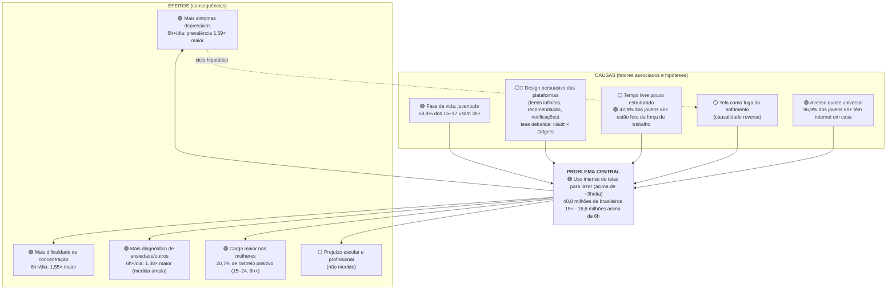

# Árvore de Problemas (rascunho baseado em evidências)

**Projeto de Extensão IESB · Grupo 1 · Insumo para a trilha qualitativa (RH)**

> **Como ler:** cada elemento tem um selo que diz **de onde vem a afirmação**. Isso evita apresentar hipótese como fato.
>
> 🟢 **Dado PNS 2019:** medido nos microdados oficiais (com número) · 🔵 **Literatura verificada:** referência real, conferida · ⚪ **Hipótese:** plausível, mas precisa de revisão de literatura pelo RH ou de pesquisa com usuários
>
> ⚠️ A PNS é transversal: ela mostra **associações**, não causas. As setas "causa → problema → efeito" abaixo são o **modelo explicativo proposto**, não algo provado pelos dados.

---

## 1. A árvore

---

## 2. Detalhamento

### Problema central

| Elemento | Selo | Evidência |
|---|---|---|
| Uso de telas para lazer acima de ~3h/dia | 🟢 | 24,2% dos brasileiros 15+ (40,8 milhões); 9,9% acima de 6h (16,6 milhões). O limiar de ~3h é **exploratório**: surgiu da análise, sem ser hipótese prévia (`docs/04` §3) |

### Causas e fatores associados

| Elemento | Selo | O que se sabe | O que o RH deve investigar |
|---|---|---|---|
| Juventude | 🟢 | O uso 3h+ cai de 58,8% (15–17) para 5,7% (60+). Associação descritiva, não causal | Por que essa fase da vida concentra o uso? (identidade, socialização, lazer acessível) |
| Design persuasivo | ⚪🔵 | Haidt (2024) atribui o aumento de sofrimento em jovens ao smartphone e às redes; Odgers (2024, *Nature*) contesta a evidência causal. A PNS **não mede** design nem plataforma | Literatura sobre economia da atenção e recomendação algorítmica, tratando o tema como debate, não consenso |
| Tempo livre pouco estruturado | ⚪ + 🟢 | Entre jovens com 6h+: 42,9% fora da força de trabalho e 48,9% frequentam escola. Nos jovens que usam <3h: 37,0% e 42,2%. Diferenças pequenas e descritivas | Relação entre ociosidade, falta de alternativas de lazer e uso intenso |
| Tela como fuga do sofrimento | ⚪ | Não testável com dados transversais. É a explicação alternativa mais importante (seta tracejada) | Estudos longitudinais sobre o sentido da relação |
| Acesso quase universal | 🟢 | 96,9% dos jovens com 6h+ têm internet em casa | É condição para o problema, não causa |

### Efeitos

| Elemento | Selo | Evidência (razão de prevalência ajustada, 6h+ vs <1h) |
|---|---|---|
| Sintomas depressivos | 🟢 | 1,59 [1,39; 1,83]; resistente a 144 especificações |
| Dificuldade de concentração | 🟢 | 1,55 [1,31; 1,83]; medida por item único |
| Diagnóstico de ansiedade/outros | 🟢 (medida fraca) | 1,38 [1,14; 1,66]; o diagnóstico autorreferido agrupa transtornos |
| Problemas de sono | 🟡 descritivo | 14,8% dos jovens 6h+ vs 8,9% dos jovens que usam <3h. **Sem ajuste**: o sono foi tratado como **mediador** e não entrou como desfecho nos modelos |
| Carga maior nas mulheres | 🟢 | Rastreio positivo: 15,1% das mulheres vs 6,0% dos homens; 20,7% entre mulheres 15–24 com 6h+. Indício de mais casos absolutos por uso intenso (p = 0,052) |
| Prejuízo escolar e profissional | ⚪ | Não medido na PNS |

---

## 3. Como o Grupo 2 usa esta árvore

- **Atacar o problema central** (tempo acima de ~3h), não os efeitos diretamente: a solução não é clínica.
- As **causas ⚪** são onde a pesquisa com usuários do Grupo 2 tem mais a descobrir.
- O **ciclo hipotético** (sofrimento → fuga → mais tela → mais sofrimento) sugere que a solução também acolha quem já está em sofrimento. Ver o protocolo de segurança no [Briefing §7](06_Briefing_Grupo2.md#7-restrições-éticas-e-legais-obrigatórias).

Fontes dos números: [`outputs/resultados_estatisticos.md`](../outputs/resultados_estatisticos.md) e [`outputs/indicadores_grupo2.csv`](../outputs/indicadores_grupo2.csv). Referências: [`05_Agenda_de_Pesquisa.md`](05_Agenda_de_Pesquisa.md#referências-todas-verificadas).
